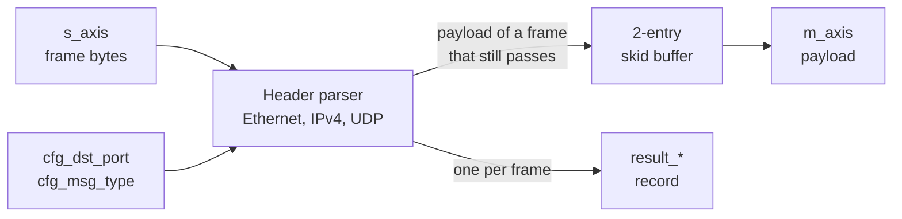
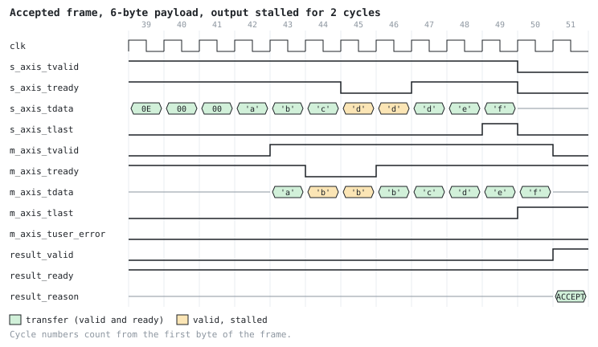
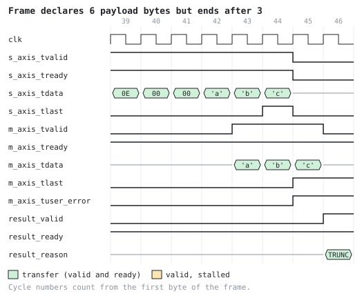

# Streaming UDP Packet Filter

[](https://github.com/Kevinchen1104/rtl-streaming-udp-filter/actions/workflows/ci.yml)

A SystemVerilog block that sits behind an Ethernet MAC and keeps only the UDP
traffic you care about. It reads each frame one byte per cycle, drops anything
that is not IPv4/UDP to the configured port (optionally, also anything whose
payload does not start with a configured message-type byte), and streams the
matching payload out one cycle after it arrives. For every frame it also
produces a result record: accepted or not, why, the addresses and ports, and a
sequence number.

This is the kind of front-end filter used in FPGA network appliances, for
example to pick one feed and one message type out of a market-data stream
before any further processing.

| | |
|---|---|
| Interfaces | 8-bit AXI4-Stream-style input and output, plus a result record with its own valid/ready |
| Throughput | 1 byte per cycle; 1-2 idle input cycles between frames |
| Latency | First payload byte out 1 cycle after it is accepted |
| FPGA | Lattice ECP5-25F: 1,019 logic cells, 346 FFs, 126-132 MHz across 5 placement seeds (125 MHz = 1 Gb/s) |
| | Basys 3 (Artix-7 XC7A35T), Vivado: 327 LUTs, 341 FFs, meets 125 MHz with 2.3 ns of slack |
| Verification | Python reference model; 59 cocotb tests including 800 random frames; formal proof of the handshake properties |

## How it works



The parser counts header bytes and checks each field as soon as its last
byte arrives. A frame that fails a check is read to its end and dropped, with
nothing on the output. Once the 42-byte header has passed, the payload streams
through a two-entry skid buffer to the output.



Above, the last header bytes and a 6-byte payload, recorded from simulation.
The output stalls at cycles 44-45. The input keeps going for one more byte
(it lands in the skid register), then `s_axis_tready` drops. Once the output
moves again, the result record follows the last payload byte.

### Cut-through, and frames that end early

The block forwards payload before the frame has ended (cut-through) instead
of storing the whole frame first (store-and-forward). That keeps latency at
one cycle and needs no frame-sized memory, but a frame can turn out to be
short after some payload has gone out. Those bytes cannot be recalled, so the
last one carries `m_axis_tlast = 1` and `m_axis_tuser_error = 1`, and the
result record says `BAD_LENGTH_OR_TRUNCATED`. A consumer that must see only
complete frames buffers the payload until the result record says accept.



## Design decisions

- **Registered input ready.** The payload buffer is an output register plus a
  skid register, so `s_axis_tready` comes from a flop and `m_axis_tready` has
  no combinational path to it. A one-entry buffer would be smaller, but chained
  blocks would then form one long combinational ready path.
- **One rule for the result reason.** The reason is the first check that fails
  in a fixed order: eligibility (EtherType, IPv4 header, length limit,
  protocol, fragmentation), then lengths and truncation, then port, then
  message type. It depends only on the frame's bytes, not on which byte the
  frame happened to end on. See [spec.md](docs/spec.md#which-reason-applies).
- **Timing.** The first version reached 106 MHz on the ECP5. Its critical path
  went through a +1 adder and a 16-bit comparator in the same cycle. Counting
  the payload down with registered `== 1` and `> 1` flags, and checking the
  UDP lengths one byte early, brought the slowest seed to 126 MHz.
- **Gap between frames.** Handing off the result record costs one or two idle
  input cycles per frame. On a 1 Gb/s link the MAC's output is already idle for
  at least 20 byte times between frames, so this does not limit throughput.

More detail: [architecture](docs/architecture.md).

## Supported frames

- Raw Ethernet II bytes starting at the destination MAC; no preamble, SFD,
  or FCS.
- IPv4 without options, protocol UDP, not fragmented, with
  `udp_length == ip_total_length - 20`.
- Ethernet padding after the datagram is read and dropped.
- Checksums are not checked.

Everything else is listed in the [specification](docs/spec.md) and
[limitations](docs/limitations.md).

## Verification

- **Reference model.** `sim/reference_model.py` classifies a whole frame by
  walking the specification's checks in order. 84 pytest tests cover it,
  including hand-written hex vectors that pin down byte order.
- **Simulation.** 59 cocotb tests on Icarus Verilog, one per scenario. Every
  payload byte and result record is compared with the model. 800 random frames
  (4 fixed seeds) mix every reason, payload sizes, padding, truncation points,
  and input, output, and result stalls. All 39 declared coverage bins are hit
  at least 5 times, or the run fails.
- **Formal.** SymbiYosys proves, for all reachable states, that stalled data
  holds, that a result record appears only for a frame that has ended and only
  after its payload is out, and that a pending record blocks the next frame.
- **Lint.** Verilator `--Wall` with no warnings.

Reports: [regression](results/regression_summary.md),
[verification matrix](results/verification_matrix.md),
[coverage](results/functional_coverage.md),
[latency](results/latency_metrics.md), [FPGA](results/fpga_summary.md),
[formal](results/formal_summary.md), [Vivado](results/vivado_summary.md). How each property is checked:
[verification plan](docs/verification-plan.md).

## Running it

Needs Python 3.11+ and [OSS CAD Suite](https://github.com/YosysHQ/oss-cad-suite-build)
(Yosys, Icarus Verilog, Verilator, nextpnr-ecp5, SymbiYosys) on `PATH`. CI
uses the 2026-10-01 build, the same one that produced the files in `results/`.

```bash
python -m venv .venv
.venv/bin/python -m pip install -r requirements-dev.txt
.venv/bin/python scripts/run_all.py
```

On Windows, use `.venv\Scripts\python`. A full run takes about 3 minutes,
stops at the first failure, and rewrites `results/`.

With Vivado installed, `python scripts/run_vivado.py` reruns the Basys 3
implementation (about 3 minutes) and updates `results/vivado_summary.md`.
CI cannot run Vivado, so that report is only updated this way.

## Repository layout

| Path | Contents |
|---|---|
| `rtl/` | The design |
| `sim/` | Reference model, packet builder, cocotb tests, coverage bins |
| `formal/` | SymbiYosys properties and job file |
| `synth/` | Generic Yosys synthesis script |
| `scripts/` | `run_all.py` and the steps it runs |
| `docs/` | Specification, architecture, verification plan, limitations |
| `results/` | Generated reports and waveforms |

## License

[MIT](LICENSE)
