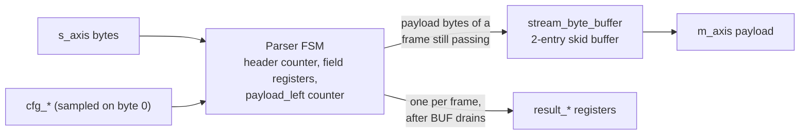
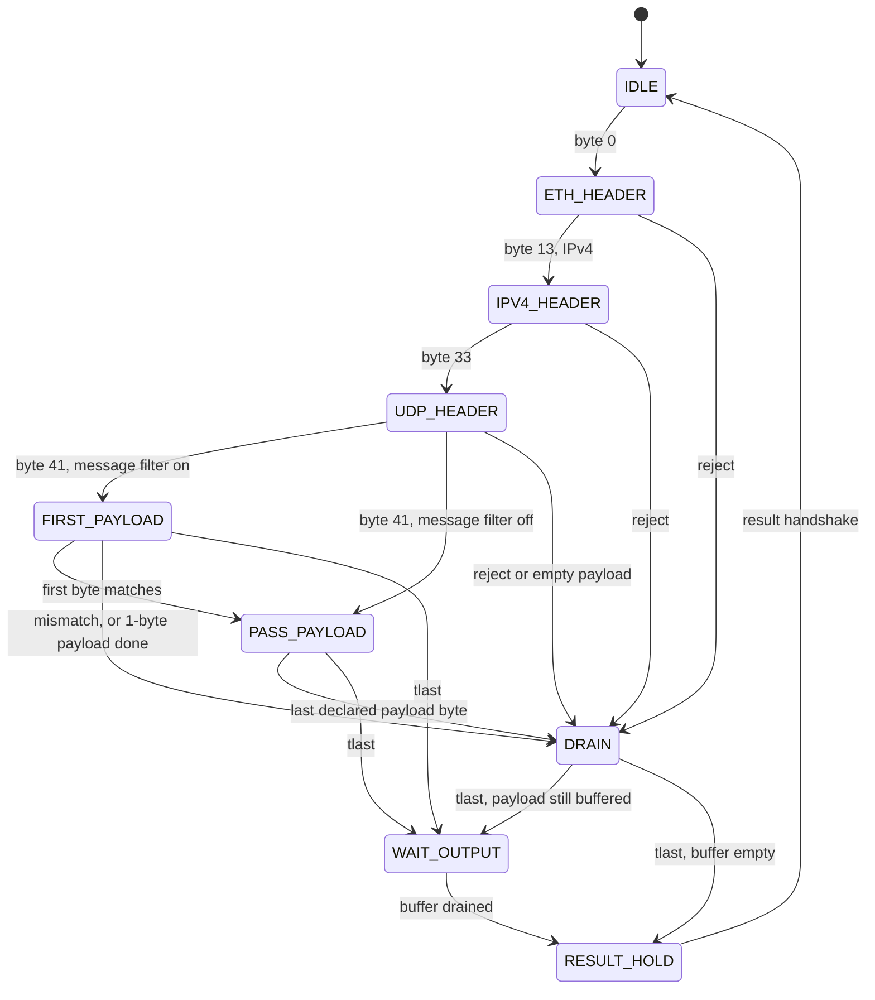

# Architecture

How `udp_packet_filter` implements [spec.md](spec.md).

## Blocks

| File | Contents |
|---|---|
| `rtl/udp_packet_filter.sv` | Parser state machine, field registers, result registers |
| `rtl/stream_byte_buffer.sv` | Two-entry skid buffer for the payload stream |
| `rtl/udp_packet_filter_reason_codes.svh` | Reason values, included by the modules that use them |
| `rtl/udp_packet_filter_checks.sv` | Simulation-only assertions (excluded when `SYNTHESIS` is defined) |

## State machine

The diagram leaves out the many "`tlast` arrives early" edges straight to
`RESULT_HOLD`. Every counter and transition advances only on an input
handshake, except `WAIT_OUTPUT` and `RESULT_HOLD`, which wait on the output
side.

- **Header states** decode bytes by `header_index`, a 6-bit counter that stops
  after byte 41. 16-bit fields keep their high byte in `field_hi` and are
  written when the low byte arrives; IP addresses shift through
  `address_shift` and are written on their fourth byte.
- **`FIRST_PAYLOAD`** is used only with message filtering on. Input ready
  comes from the buffer as in the pass state; the byte is written to the
  buffer only if it matches. A mismatching byte is accepted and dropped.
- **`DRAIN`** reads and drops bytes until `tlast`: after a reject, and after
  the declared payload when Ethernet padding follows.
- **`WAIT_OUTPUT`** holds input ready low after `tlast` until the last payload
  beat has left the buffer, so the result record never overtakes payload.
- **`RESULT_HOLD`** presents the result record until `result_ready`.

## Where each check happens

- EtherType at byte 13, version/IHL at byte 14, the length limit at byte 17.
  The limit is compared against the constant `MAX_LOGICAL_FRAME_BYTES - 14`
  rather than adding 14 at runtime.
- Fragmentation is latched at byte 21 and checked with the protocol at byte
  23, so `NON_UDP` wins over `FRAGMENTED`.
- The UDP length rules and the port match are computed at byte 40 into
  `lengths_ok` and `port_match`, and acted on at byte 41.

At byte 41 the parser loads `payload_left` with the declared payload length
and counts it down on every payload byte, including while draining a port or
message reject. Eligibility rejects leave it at zero. Two flags,
`payload_one` (`payload_left == 1`) and `payload_many` (`> 1`), are registered
next to the counter. When `tlast` arrives with `payload_many` set, the frame is
truncated, whatever reason was pending (`close_reason`). This produces the
whole-frame priority order in the specification without special cases for
the byte the frame ends on.

## Payload buffer

`stream_byte_buffer` is an output register plus one skid register. When the
output stalls, one more byte can land in the skid register; then input ready
drops. Input ready is `!skid_valid`, a flop output, so `m_axis_tready` has no
combinational path to `s_axis_tready`. When the output frees up, the skid byte
moves to the output register and input ready returns one cycle later; the
output side keeps moving one byte per cycle throughout. The `drained` output
tells the parser when no byte will remain after the current edge.

The trade-off is one extra 10-bit register. Without it, a chain of these
blocks would build one long combinational ready path from the last sink back
to the first source.

## Timing

The first version reached 106 MHz on an ECP5 (see
[FPGA results](../results/fpga_summary.md)). The critical path ran the payload
counter through a +1 adder into a 16-bit comparator and then into the result
muxes, two carry chains in one cycle. Three changes brought the slowest
placement seed to 126 MHz, above the 125 MHz needed for 1 Gb/s at 8 bits:

1. Count the payload down and register the `== 1` and `> 1` flags, so the
   truncation check and the last-beat flag are single flops.
2. Compute the UDP length rules and the port match one byte early.
3. Compare the IPv4 total length against a constant.

## Reset

Reset is synchronous, but `s_axis_tready`, `m_axis_tvalid`, and
`result_valid` are also gated by `rst_n` directly, so they are low for the
whole reset, including before the first clock edge. This puts `rst_n` in a
combinational path to those three outputs. It assumes `rst_n` comes from a
reset synchronizer, as it would in a real system.

## Gap between frames

After `tlast`, the parser spends one cycle in `RESULT_HOLD` while the result
record is handed off, then returns to `IDLE`. A frame whose last byte was
forwarded payload first spends one cycle in `WAIT_OUTPUT` while that byte
leaves the buffer. So input is not ready for one or two cycles between frames
when both sinks are ready. On a 1 Gb/s link this costs nothing: between two
frames the MAC's output is idle for at least 20 byte times (12 bytes of
inter-frame gap plus 8 bytes of preamble and SFD).

## Not implemented

VLAN tags, IP options, reassembly, and checksums need more parsing or storage.
More than one result record in flight would need a result FIFO and a way to
tie payload to records. There is no timeout because the interface has no
start-of-frame signal to resynchronize on.
