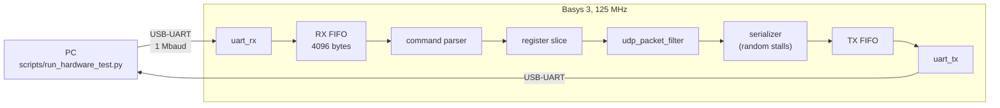

# Hardware test on a Basys 3

The filter runs on a Digilent Basys 3 (Artix-7 XC7A35T) at 125 MHz. A PC
sends Ethernet frames over the board's USB-UART, and checks every payload
byte and result record that comes back against the Python reference model.
The latest run is in [results/hardware_test.md](../results/hardware_test.md).

## Setup



| File | Contents |
|---|---|
| `fpga/basys3/basys3_top.sv` | MMCM (100 to 125 MHz), reset, LEDs |
| `fpga/basys3/hw_test_core.sv` | Command parser, filter, response serializer |
| `fpga/basys3/uart_rx.sv`, `uart_tx.sv` | UART |
| `fpga/basys3/bram_fifo.sv`, `sync_fifo.sv` | RX FIFO in block RAM, small TX FIFO in LUT RAM |
| `fpga/basys3/basys3.xdc` | Pins and clock |
| `fpga/basys3/build.tcl`, `program.tcl` | Vivado build and JTAG load |
| `sim/hw_protocol.py` | Byte protocol, shared by the PC script and the simulation |
| `sim/hw_wrapper_testbench.py` | cocotb test of the harness with a fast UART |
| `scripts/run_hardware_test.py` | Build, load, run, and report |

## How it works

- The UART is far slower than the filter, so the board first buffers a whole
  frame, then streams it into the filter with valid held high: the filter sees
  back-to-back bytes at 125 MHz, as it would behind a 1 Gb/s MAC.
- Each frame command carries the filter configuration and a stall level. The
  serializer drops `m_axis_tready` and `result_ready` at random, at that rate,
  so the skid buffer and the result hold run on silicon.
- Payload beats come back as tagged bytes carrying `last` and `error`, and the
  result record as 20 bytes. The protocol is described at the top of
  `sim/hw_protocol.py`.
- The PC sends frames in batches that fit the board's 4096-byte RX FIFO,
  then reads all the answers. LED 1 lights if the FIFO ever overflows.

## What is sent

- Every directed frame from the simulation, once with no stalls and once with
  heavy stalls.
- The header truncation sweep: the frame closed after each of the 42 header
  bytes.
- Random frames from the same generator as the simulation, for seeds 1, 7,
  42, and 2027, with random stall levels.

## Running it

Needs Vivado, a Basys 3 on USB, and pyserial:

```bash
python -m pip install -r requirements-hw.txt
python scripts/run_hardware_test.py
```

The bitstream is loaded over JTAG, so it is lost at power-off and the board's
flash is not changed. `--skip-build` reuses the last bitstream,
`--skip-program` uses whatever the board is running, and `--port` picks the
serial port if it is not found automatically.

## What this does not show

The UART carries about 100 KB/s, so this checks that the filter is correct on
real hardware at 125 MHz, not that it sustains 1 Gb/s end to end; throughput
inside the FPGA is covered by simulation. The Basys 3 has no Ethernet port, so
frames come from the PC rather than a MAC.
